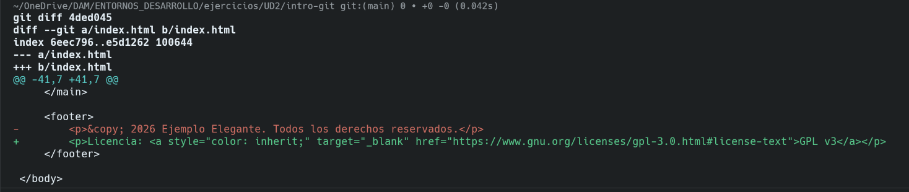
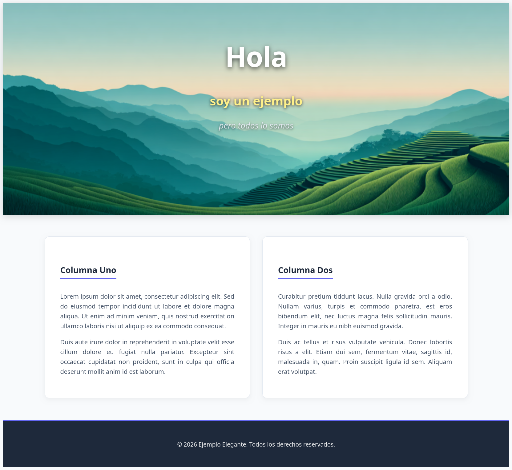

# Ejercicio GIT - UD2

Proyecto de prueba para la práctica de control de versiones con Git. Consiste en una web básica compuesta por un encabezado principal con imagen y un cuerpo distribuido en dos columnas con texto *Lorem Ipsum*.

